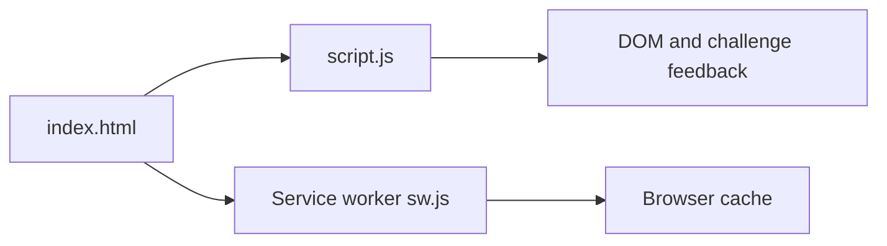

# CodeHunt

## Project overview

CodeHunt is a browser-based coding challenge/game prototype implemented without a framework. It packages a challenge-oriented interface with a custom visual identity and progressive web app assets for installable browser use.

## Purpose

The project experiments with presenting coding questions as an interactive, game-like web experience rather than a plain form.

## Implementation

- `index.html` provides the main application page.
- `script.js` contains client-side interaction and challenge behavior.
- `style.css` defines the interface presentation.
- `manifest.json`, `sw.js`, and the icon files provide PWA metadata and service-worker support.
- `logo.html` and `logo3d.js` contain the visual/logo experiment.

## Application flow

## Run locally

Open `index.html` directly for a simple preview, or serve the repository with a static HTTP server when testing service-worker behavior. No package manager installation is required by the repository.

## Current limitations

This is a client-only prototype. The repository does not include a server, database, authentication system, or automated test command.

## Future improvements

Potential follow-up work includes a formal challenge data model, progress persistence, accessibility review, and automated browser tests.

## License

No license is currently declared.
